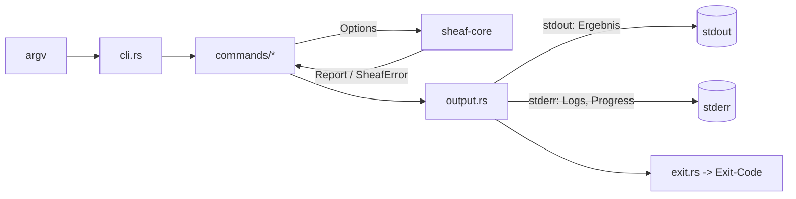

# SHEAF – Milestone 2: CLI-Fundament + Split

> Basis: Stand nach Milestone 0 + 1 (Workspace, `SheafError`, `Progress`, `merge()`, CLI `merge`, `lopdf 0.46.0`, `clap 4.6.7`, `qpdf` installiert).
> Abschnitt **1** als Prompt an den Agent, Abschnitt **2** an `AGENTS.md` anhängen. Rest ist die Spezifikation.

---

# 1. Prompt an den Agent

```text
Milestone 0 und 1 sind abgenommen. Starte Milestone 2.

Ziel: Die CLI wird zur vollständigen, agent-tauglichen Steuerung von Sheaf.
Danach folgt Split. Lies zuerst SHEAF_MILESTONE_2.md komplett und halte dich an den CLI-Vertrag.

Reihenfolge (strikt, je Schritt ein Commit, fmt + clippy -D warnings + test grün):

2.1  CLI-Fundament
     - CLI-Struktur refactoren (cli.rs, output.rs, exit.rs, commands/)
     - Globale Flags, JSON-Envelope, Exit-Code-Mapping, atomisches Schreiben
     - merge auf das neue Output-System migrieren (Verhalten bleibt gleich)
     - neue Befehle: info, verify, capabilities
2.2  Split in sheaf-core (PageSelection, SplitMode, split())
2.3  Split in der CLI (inkl. --dry-run und --json)
2.4  Tests laut Abschnitt 8

Regeln:
- Keine Crates oder APIs raten: cargo add + docs.rs prüfen, Versionen nennen.
- Logik nur in sheaf-core, CLI bleibt dünn.
- Neue SheafError-Varianten sind erlaubt (siehe Abschnitt 3), Mapping muss exhaustive sein.
- Kein unwrap/expect in Library-Code.

Am Ende: Zusammenfassung (gebaut, Abweichungen, offen) und Vorschlag für Milestone 3.
Starte Milestone 3 NICHT ohne meine Freigabe.
```

---

# 2. Ergänzung für `AGENTS.md`

````markdown
## CLI-Vertrag (verbindlich für jedes Feature)

- Jedes Feature ist per CLI nutzbar, bevor es eine UI bekommt. Kein Feature ohne Subcommand.
- Nie interaktiv: keine Prompts, keine Rückfragen. Fehlende Infos = Fehler + Exit-Code.
- stdout = ausschließlich Ergebnis (bei --json genau EIN JSON-Objekt). stderr = Logs, Fortschritt, Warnungen.
- Jeder Befehl unterstützt: --json, --dry-run, --force, --quiet, --progress, --no-color.
- Ausgabedateien werden atomisch geschrieben (temp-Datei im Zielordner, dann rename).
- Bestehende Ausgabedatei ohne --force = Fehler OutputExists (Exit 7). Eingabedatei wird nie überschrieben.
- Exit-Codes und JSON-Fehlercodes sind stabil (Tabelle in SHEAF_MILESTONE_2.md). Änderungen nur mit Schema-Version-Bump.
- JSON-Envelope trägt "schema": 1. Felder werden nur hinzugefügt, nie umbenannt/entfernt.
- Jeder Subcommand: --help mit mindestens zwei Beispielen (clap `after_help`).
- Result-/Report-Structs liegen in sheaf-core (derive Serialize), die CLI serialisiert sie nur.
- Neues Feature = neuer Subcommand + CLI-Integrationstest (assert_cmd) + Eintrag in `sheaf capabilities`.
````

---

# 3. Änderungen an `sheaf-core`

## Neue/angepasste Fehler

| Variante | `code()` (stabil) | Exit | Wann |
|---|---|---|---|
| `Io` | `io` | 6 | Datei fehlt, keine Rechte |
| `InvalidPdf` | `invalid_pdf` | 3 | kaputtes PDF |
| `Encrypted` | `encrypted` | 4 | passwortgeschützt |
| `WrongPassword` | `wrong_password` | 4 | falsches Passwort |
| `PageOutOfRange` | `page_out_of_range` | 5 | Seite `0` oder `> total` |
| `EmptySelection` | `empty_selection` | 2 | leerer Seitenbereich |
| **`InvalidSelection`** (neu) | `invalid_selection` | 2 | Syntaxfehler, `5-3`, `abc`, `N=0` |
| **`OutputExists`** (neu) | `output_exists` | 7 | Ziel existiert, kein `--force` |
| `Unsupported` | `unsupported` | 8 | z. B. keine Lesezeichen |
| `Cancelled` | `cancelled` | 130 | Abbruch |
| (Fallback) | `internal` | 1 | unerwartet |

- `SheafError::code(&self) -> &'static str` und `hint(&self) -> Option<&'static str>` in **core**.
- `exit_code()` Mapping in **`sheaf-cli/src/exit.rs`** mit exhaustive `match` (neue Variante = Compile-Fehler).
- Fehlermeldungen bleiben deutsch (Mensch), `code` ist englisch und stabil (Maschine).

## Gemeinsame Helfer

```rust
// crates/sheaf-core/src/fs.rs
/// Schreibt atomisch: temp-Datei im Zielordner, dann rename.
pub fn write_atomic(path: &Path, force: bool, f: impl FnOnce(&mut File) -> Result<(), SheafError>)
    -> Result<(), SheafError>;   // OutputExists, wenn path existiert && !force
```

- `serde` (derive) und `serde_json` per `cargo add`, `Serialize` auf allen Reports.
- `pub const SCHEMA_VERSION: u32 = 1;`

---

# 4. CLI-Architektur

## Crate-Layout

```
crates/sheaf-cli/src/
├─ main.rs          # parse -> run -> exit(code)
├─ cli.rs           # clap-Definitionen (Cli, Commands, GlobalArgs)
├─ output.rs        # Renderer: human | json, Envelope, stderr-Logging
├─ exit.rs          # SheafError -> Exit-Code (exhaustive)
├─ progress.rs      # impl Progress: none | human (TTY) | json (NDJSON)
└─ commands/
   ├─ mod.rs        # trait Command
   ├─ merge.rs
   ├─ split.rs
   ├─ info.rs
   ├─ verify.rs
   └─ capabilities.rs
```



```rust
pub trait Command {
    type Report: serde::Serialize;
    fn name(&self) -> &'static str;
    fn run(&self, ctx: &Ctx) -> Result<Outcome<Self::Report>, SheafError>;
}
pub struct Outcome<R> { pub report: R, pub warnings: Vec<String>, pub dry_run: bool }
// Ctx: GlobalArgs (json, force, dry_run, quiet, progress), Progress-Impl
```

## Globale Flags (auf jedem Subcommand)

| Flag | Wirkung |
|---|---|
| `--json` | stdout = genau ein JSON-Objekt (Envelope), nichts anderes |
| `--dry-run` | validiert Eingaben, berechnet Plan, schreibt **nichts**; Envelope enthält `"dry_run": true` |
| `--force` | vorhandene Ausgabedateien überschreiben |
| `-q, --quiet` | keine Human-Ausgabe außer Fehlern |
| `-v, --verbose` | Debug-Logs auf stderr |
| `--progress <none\|human\|json>` | Default: `human` bei TTY, sonst `none`. `json` = NDJSON auf stderr |
| `--no-color` | zusätzlich `NO_COLOR` respektieren |

Reserviert für später (noch nicht implementieren): `--password-env <VAR>`, `--password-stdin`.

## JSON-Envelope

**Erfolg**
```json
{
  "schema": 1,
  "ok": true,
  "op": "split",
  "dry_run": false,
  "data": { },
  "warnings": [],
  "duration_ms": 84
}
```

**Fehler** (stdout bei `--json`, Exit-Code ≠ 0)
```json
{
  "schema": 1,
  "ok": false,
  "op": "split",
  "error": {
    "code": "page_out_of_range",
    "exit_code": 5,
    "message": "Seite 99 existiert nicht (Dokument hat 12 Seiten).",
    "hint": "Gültiger Bereich: 1-12."
  }
}
```

**Fortschritt** (`--progress json`, NDJSON auf stderr)
```json
{"event":"progress","op":"split","done":3,"total":10}
{"event":"warning","message":"Lesezeichen ohne Ziel übersprungen: Anhang"}
```

## Exit-Codes

| Code | Bedeutung | JSON `code` |
|---|---|---|
| 0 | OK | – |
| 1 | Interner Fehler | `internal` |
| 2 | Ungültige Argumente/Auswahl | `invalid_selection`, `empty_selection` (clap-Fehler ebenfalls 2) |
| 3 | Ungültiges/kaputtes PDF | `invalid_pdf` |
| 4 | Verschlüsselt / falsches Passwort | `encrypted`, `wrong_password` |
| 5 | Seite außerhalb des Bereichs | `page_out_of_range` |
| 6 | I/O-Fehler | `io` |
| 7 | Ausgabedatei existiert | `output_exists` |
| 8 | Nicht unterstützt | `unsupported` |
| 130 | Abgebrochen (Ctrl+C) | `cancelled` |

- Bei `--json` auch clap-Parsefehler als Envelope ausgeben (`error.code = "invalid_selection"` bzw. `usage`), Exit 2.
- Ctrl+C setzt ein `AtomicBool`, das `Progress::is_cancelled()` liefert (`ctrlc`-Crate, Version via `cargo add`).

---

# 5. Befehle in diesem Milestone

## `info`

```bash
sheaf info <file>... [--json]
```

| Feld (`data.files[]`) | Typ |
|---|---|
| `path`, `size_bytes`, `pdf_version` | string, int, string |
| `pages` | int (bei verschlüsselt: `null`) |
| `encrypted` | bool |
| `metadata` | `{title, author, subject, keywords, creator, producer}` (nullable) |
| `has_outlines`, `outline_count` | bool, int |
| `first_page_size_pt` | `[w, h]` |

- Verschlüsselte PDFs: **Exit 0** mit `encrypted: true`, `pages: null` (Info ist kein Fehler).
- Kaputte Datei: Exit 3.

## `verify`

```bash
sheaf verify <file>... [--deep] [--json]
```

- Prüft: lädt fehlerfrei, Page-Tree vollständig traversierbar, jede Seite hat auflösbare Objekte, Seitenzahl > 0.
- `--deep`: zusätzlich `qpdf --check`, falls im PATH. Fehlt `qpdf`: Warning, kein Fehler.
- Ergebnis je Datei `{path, valid, pages, problems: []}`. Exit 3, sobald **eine** Datei ungültig ist; alle werden trotzdem geprüft.

## `capabilities`

```bash
sheaf capabilities --json
```

Selbstbeschreibung für Agents. Liefert Version, Schema-Version, Befehlsliste mit Flags, Exit-Code-Tabelle, ob `qpdf` verfügbar ist.

```json
{
  "schema": 1, "ok": true, "op": "capabilities",
  "data": {
    "version": "0.1.0",
    "commands": [
      {"name": "merge", "args": ["inputs...", "-o"], "status": "stable"},
      {"name": "split", "args": ["input", "--ranges", "--every", "--bookmarks-level", "--combine", "-o"], "status": "stable"}
    ],
    "exit_codes": {"0": "ok", "2": "usage", "3": "invalid_pdf"},
    "tools": {"qpdf": true}
  }
}
```

## `merge` (migriert)

- Verhalten unverändert, aber: `--json`, `--dry-run`, `--force`, atomisches Schreiben, Reports.
- `data`: `{inputs: [...], output, pages_total}`.

---

# 6. Split – Spezifikation

## Seitenbereichs-Syntax

| Eingabe | Bedeutung |
|---|---|
| `3` | Seite 3 |
| `1-3` | Seiten 1 bis 3 |
| `8-` | Seite 8 bis Ende |
| `-3` | Seiten 1 bis 3 |
| `1-3,5,8-` | mehrere Tokens, Duplikate/Überlappung erlaubt |

| Fall | Ergebnis |
|---|---|
| leerer String | `EmptySelection` |
| `0`, `13` bei 12 Seiten | `PageOutOfRange` |
| `5-3` (umgekehrt) | `InvalidSelection` |
| `abc`, `1--3`, `,,` | `InvalidSelection` |
| Leerzeichen um Tokens | werden getrimmt |

## Core-API

```rust
pub struct PageSelection(Vec<RangeInclusive<u32>>);
impl PageSelection {
    pub fn parse(input: &str, total: u32) -> Result<Self, SheafError>;
    pub fn ranges(&self) -> &[RangeInclusive<u32>];
}

pub enum SplitMode {
    Ranges { selection: PageSelection, combine: bool },
    EveryN(u32),                      // N >= 1, sonst InvalidSelection
    ByBookmarks { level: u8 },        // level >= 1
}

pub struct SplitOptions { pub mode: SplitMode, pub out_dir: PathBuf, pub force: bool, pub dry_run: bool }

#[derive(Serialize)]
pub struct SplitReport {
    pub input: PathBuf, pub input_pages: u32, pub mode: &'static str,
    pub outputs: Vec<SplitOutput>,
}
#[derive(Serialize)]
pub struct SplitOutput { pub path: PathBuf, pub pages: u32, pub page_range: Option<(u32, u32)>, pub title: Option<String> }

pub fn split(src: &Path, opts: &SplitOptions, p: &dyn Progress) -> Result<SplitReport, SheafError>;
```

## Modi und Dateinamen

| Modus | Ergebnis | Dateiname |
|---|---|---|
| Ranges (default) | eine Datei **pro Token** | `{stem}_p{von}-{bis}.pdf` (einzelne Seite: `{stem}_p{n}.pdf`) |
| Ranges + `--combine` | **eine** Datei, Seiten in angegebener Reihenfolge | `{stem}_selection.pdf` |
| EveryN | Blöcke à N Seiten, letzter Block kürzer | `{stem}_part{nn}.pdf` (zweistellig, bei >99 Teilen dreistellig) |
| ByBookmarks | Abschnitt = Lesezeichen bis zum nächsten auf gleichem Level | `{stem}_{nn}_{slug}.pdf` |

**ByBookmarks – Regeln**
- `level 1` = oberste Ebene. Abschnitt reicht von Zielseite bis (nächste Zielseite − 1), letzter bis Dokumentende.
- Seiten **vor** dem ersten Lesezeichen: eigener Teil `{stem}_00_front.pdf`.
- Lesezeichen ohne auflösbares Ziel: überspringen + Warning.
- Kein Lesezeichen auf dem Level: `Unsupported` mit Hint "Dokument hat keine Lesezeichen auf Ebene N".
- `slug`: Kleinbuchstaben, nur `a-z0-9-`, max. 40 Zeichen, Umlaute transliterieren (`ä`→`ae`), bei Kollision `-2`, `-3`.

## Implementierungshinweise

- PDF **einmal** laden, pro Ausgabe `Document` klonen, mit `delete_pages` auf Zielseiten reduzieren, `prune_objects()`, speichern. Nicht pro Ausgabe neu von Disk laden.
- Outlines im Split-Output werden entfernt (verwaiste Referenzen vermeiden). In der Doku vermerken.
- Metadaten (Info-Dict) bleiben erhalten.
- Alle Zieldateien **vorab** prüfen (`OutputExists`), bevor die erste geschrieben wird. Kein halber Output.
- `Progress`: ein Schritt pro Ausgabedatei, `is_cancelled()` zwischen den Dateien prüfen.
- Default `out_dir` = Ordner der Eingabedatei. Ordner wird bei Bedarf angelegt.
- Dateinamen niemals aus ungeprüften Titeln übernehmen (Pfad-Traversal: `/`, `..` entfernen, nur Slug).

---

# 7. CLI-Aufruf Split

```bash
sheaf split <input> --ranges "1-3,5,8-" [--combine] [-o <out_dir>] [--force] [--dry-run] [--json]
sheaf split <input> --every 2 -o out/
sheaf split <input> --bookmarks-level 1 -o out/
```

- `--ranges`, `--every`, `--bookmarks-level` sind **gegenseitig exklusiv** (clap `ArgGroup`, genau eines Pflicht).
- `--combine` nur mit `--ranges` (sonst Usage-Fehler, Exit 2).

**Beispiel-Output** (`--json`)
```json
{
  "schema": 1, "ok": true, "op": "split", "dry_run": false,
  "data": {
    "input": "report.pdf", "input_pages": 12, "mode": "ranges",
    "outputs": [
      {"path": "out/report_p1-3.pdf", "pages": 3, "page_range": [1, 3], "title": null},
      {"path": "out/report_p5.pdf",   "pages": 1, "page_range": [5, 5], "title": null},
      {"path": "out/report_p8-12.pdf","pages": 5, "page_range": [8, 12], "title": null}
    ]
  },
  "warnings": [], "duration_ms": 84
}
```

**Beispiel Human-Output** (Default)
```
✓ split  report.pdf (12 Seiten) → 3 Dateien in out/
  report_p1-3.pdf    3 S.
  report_p5.pdf      1 S.
  report_p8-12.pdf   5 S.
```

**Typische Agent-Schleife**
```bash
sheaf info report.pdf --json
sheaf split report.pdf --ranges "1-3,8-" -o out --dry-run --json
sheaf split report.pdf --ranges "1-3,8-" -o out --json
sheaf verify out/*.pdf --deep --json
```

---

# 8. Tests

| Ebene | Werkzeug | Inhalt |
|---|---|---|
| Unit | `cargo test` | `PageSelection::parse` mit allen Tabellen-Fällen aus Abschnitt 6 |
| Property | `proptest` | `parse` panict nie (beliebige Strings, `total` 0..1000); gültige Selection liegt immer in `1..=total` |
| Core-Integration | `cargo test` | Seitenzahl je Ausgabe, Summe bei EveryN = Original, Overlap bei Ranges, ByBookmarks mit programmatisch erzeugten Outlines |
| CLI-Integration | `assert_cmd` + `predicates` | Exit-Code-Tabelle **table-driven** (corrupted → 3, encrypted → 4, `99` → 5, fehlende Datei → 6, Ziel existiert → 7, Usage → 2) |
| Stdout-Reinheit | `assert_cmd` | Bei `--json` lässt sich komplettes stdout als **ein** JSON-Wert parsen; `--progress json` schreibt nur auf stderr |
| Snapshots | `insta` | JSON-Envelopes von info, verify, split, merge, capabilities (Dauer-Feld maskieren) |
| Dry-Run | `assert_cmd` | `--dry-run` legt keine Dateien an (Verzeichnis vorher/nachher gleich) |
| Atomik | Core-Test | Fehler mitten im Schreiben hinterlässt keine Teil-Datei |
| Validierung | `qpdf --check` | Jede erzeugte Split-Datei |
| Mapping | Unit | Jede `SheafError`-Variante hat `code()` und Exit-Code (exhaustive) |

Neue Fixtures (programmatisch erzeugen): `fixture_12p.pdf`, `fixture_outlines.pdf` (3 Kapitel auf Ebene 1, je 2 Unterkapitel auf Ebene 2), `fixture_no_outlines.pdf`.

---

# 9. Akzeptanzkriterien

- [ ] `cargo fmt --check`, `cargo clippy -- -D warnings`, `cargo test --workspace` grün
- [ ] `merge`, `split`, `info`, `verify`, `capabilities` unterstützen `--json`, `--dry-run`, `--force`, `--quiet`, `--progress`
- [ ] Bei `--json` ist stdout immer genau ein gültiges JSON-Objekt, auch bei Fehlern und clap-Parsefehlern
- [ ] Exit-Codes entsprechen der Tabelle, jede Variante ist getestet
- [ ] `--dry-run` schreibt nichts, Plan ist identisch zum echten Lauf
- [ ] Bestehende Ausgabe ohne `--force` → Exit 7, Original nie verändert
- [ ] Kein halber Output bei Fehlern oder Abbruch (Vorab-Prüfung + atomisches Schreiben)
- [ ] Split-Outputs bestehen `qpdf --check`, Seitenzahlen stimmen
- [ ] `proptest` für `PageSelection::parse` findet keine Panics
- [ ] `sheaf <cmd> --help` zeigt mindestens zwei Beispiele
- [ ] `AGENTS.md` enthält den CLI-Vertrag, README dokumentiert Befehle und Exit-Codes

---

# 10. Ausblick: alle Features als Subcommands

Gleiche Muster (Flags, Envelope, Exit-Codes) für jedes Feature. Kein Sonderweg.

| Befehl | Zweck | Milestone |
|---|---|---|
| `merge`, `split`, `info`, `verify`, `capabilities` | siehe oben | 2 |
| `pages rotate\|delete\|reorder\|extract <file> --pages "..."` | Seiten-Operationen | 3 |
| `render <file> --page N --dpi D -o img.png` | Seite als Bild, **Agent kann Ergebnis visuell prüfen** | 4 |
| `compress <file> --preset low\|medium\|high` | Komprimieren, Report mit Größe vorher/nachher | 7 |
| `convert to-images\|from-images` | PDF ↔ Bilder | 8 |
| `watermark`, `number` | Wasserzeichen, Seitenzahlen | 10 |
| `protect`, `unprotect` | Passwort (`--password-env`, `--password-stdin`) | 10 |
| `meta get\|set\|strip` | Metadaten | 10 |
| `ocr`, `redact` | OCR, Schwärzen | 10 |
| `batch <manifest.json>` | Mehrere Operationen in einem Aufruf (JSON-Manifest) | v2 |
| `completions <shell>` | Shell-Completions | optional |

- **Regel:** Ein Milestone gilt erst als fertig, wenn der zugehörige Subcommand in `capabilities` auftaucht und CLI-Tests hat.
- **Später:** `sheaf-mcp` als dünner Wrapper, der dieselben Commands und Schemas als MCP-Tools exponiert.
- **Optional:** `sheaf schema <command>` gibt das JSON-Schema des Reports aus (`schemars`).
